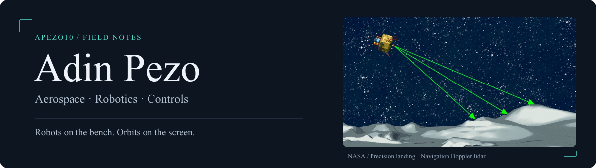
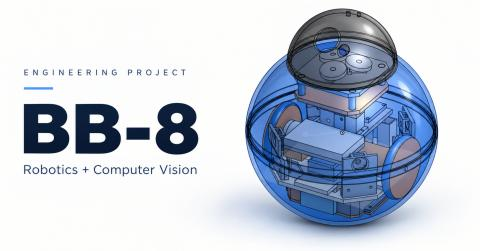
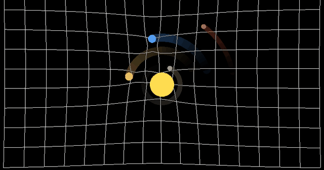

  

I'm Adin, an aerospace engineering student at **Worcester Polytechnic Institute**. I like writing code that makes something move. Sometimes that's a robot; sometimes it's a few bodies orbiting each other on my screen.

Most of my work sits somewhere between mechanics, embedded software, and figuring out what a sensor is actually telling me.

### On the bench

**[BB-8](https://github.com/Apezo10/Fully-Functional-Autonomous-BB8)**  

Building my own BB-8: a rolling robot with ESP32 control, Bluetooth input, and a computer vision pipeline. The fun part is getting the electronics, tracking, and mechanism to agree.

[Watch it move ↗](https://www.youtube.com/shorts/LJOWvPuahys) · [Detection + tracking ↗](https://www.youtube.com/shorts/c6eFDMcRZfE)

---

**[Gravity simulator](https://github.com/Apezo10/Gravity-Simulator)**  

A place to mess around with Newtonian gravity, orbital motion, and interacting bodies. Also an excuse to get better at C++ and building a GUI.

---

**Soft continuum robotics · WPI MER Lab**  
Research on a tendon-driven robot that bends instead of moving through rigid joints. I'm working with kinematics and manipulability to understand how its shape changes the motion and forces it can produce.

-> Modeling tendon driven soft 3-module robot under PCC constraints in python from actuator space to 3d task space and image space.

-> Developed an actuation-aware velocity manipulability framework through physical validation using a C++ based ROS interface.

-> Implemented a receding-horizon trajectory optimizer to improve image-space target-reaching performance compared with baseline image-based visual servoing (IBVS).

---

<b>A little more under the hood</b>

 

| Project | What I'm working with |
| :--- | :--- |
| BB-8 | ESP32, Arduino / PlatformIO, Bluepad32, OpenCV, MobileNet detection + KCF tracking |
| Gravity simulator | C++, Newtonian physics, interacting bodies, visualization |
| Continuum robotics | Kinematic models, Jacobians, velocity / force manipulability, vision-guided motion planning |

### Toolbox

`C++` · `Python` · `MATLAB`  
ROS · Simulink · OpenCV · ESP32 · Arduino  
Git · Linux · Onshape

---

If it thinks, flies, or moves, I'm probably interested.

[Browse my repos ↗](https://github.com/Apezo10?tab=repositories)

<!-- Layout inspiration: custom SVG imagery and theme-aware assets from Andrew6rant/Andrew6rant;
     collapsible sections from DenverCoder1/DenverCoder1; casual, compact copy from sindresorhus/sindresorhus.
     Artwork and wording created specifically for this profile. -->

